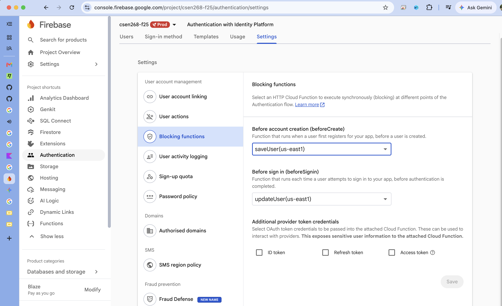

# Lecture 16 - 4 Firebase Cloud Messaging for Individual Users

## Objective
- Create new User using Firebase Authentication
    - As new user is created, create an entity in the Firestore users table with the uid, and email of the user along with other data that comes through from Firebase Authentication
- Update User details on sign in
    - Save the emailVerified status of the user
    - Save the Firebase Cloud Messaging token to the user when the user signs in on a device such that we can send messages to this particular device
- Update token on sign-out
    - When user signs out, we need to remove the FCM token from the user

Firebase Auth provides two blocking functions that are triggered before the user is created, or before the user is signed in:

[Extend Firebase Auth with Blocking Functions](https://firebase.google.com/docs/auth/extend-with-blocking-functions)

## Correct Functions installation
Ensure that your [package.json](functions/package.json) contains the correct versions:
```javascript
  "dependencies": {
    "firebase-admin": "^13.6.0",
    "firebase-functions": "^7.0.0",
    "path": "^0.12.7",
    "sharp": "^0.34.5"
  },
```

    Note that the **Identity Toolkit API** needs to be enabled in your cloud project

## Function for before creation of user
```javascript   
exports.saveUser = beforeUserCreated(async (event) => {
    const user = event.data;
    const db = getFirestore();
    const userRef = db.collection('users').doc(user.uid);
    await userRef.set({
        email: user.email ?? null,
        displayName: user.displayName ?? null,
        photoUrl: user.photoURL ?? null,
        createdAt: Timestamp.now(),
        uid: user.uid,
        emailVerified: user.emailVerified,
    }, { merge: true });
});
```
This enables us to save the user in Firestore database. We can also use this step to block the user creation (eg you only allow users with gmail.com email address..)

## Function for before sign in
```javascript
exports.updateUser = beforeUserSignedIn(async (event) => {
    const user = event.data;
    const db = getFirestore();
    const userRef = db.collection('users').doc(user.uid);
    await userRef.update({
        emailVerified: user.emailVerified,
    });
});
```
We can use this to update user details everytime the user is signed in (for example updates to his photoUrl, displayName, etc. In this case we just update **emailVerified**)

In your **Firebase** console, you need to go to **Authentication** and add these blocking functions in the shown area:


## Recording and Updating the user token
We use this function to change the tokens of the user, when he signs in and also when he signs out. These are called from `AuthenticationBloc` user sign in, sign out handlers.
```javascript
exports.updateUserToken = onCall(async (request) => {
    if (!request.data.uid || !request.data.fcmToken) {
        return { 'message': 'Invalid request' };
    }
    const uid = request.data.uid;
    const fcmToken = request.data.fcmToken;
    const action = request.data.action;
    const db = getFirestore();
    const userRef = db.doc(`users/${uid}`);
    const qs = await userRef.get();
    var fcmTokens = qs.data().fcmTokens;
    if (!fcmTokens) {
        fcmTokens = [];
    }
    if (action == 'delete') {
        fcmTokens = fcmTokens.filter(token => token !== fcmToken);
    } else if (action == 'add') {
        if (!fcmTokens.includes(fcmToken)) {
            fcmTokens.push(fcmToken);
        }
    }
    await userRef.update({
        fcmTokens: fcmTokens,
    });
    return { 'message': 'Success' };
});
```

Calling from `AuthenticationBloc` example for sign out. Similar logic for signing in and new user creation.
```dart
  Future<void> _handleSignOut(event, emit) async {
    emit(AuthenticationWaiting());
    await FirebaseFunctions.instance.httpsCallable('updateUserToken').call({
      'uid': user?.uid,
      'fcmToken': await FirebaseMessaging.instance.getToken() ?? '',
      'action': 'delete',
    });
    user = null;
    await authenticationRepository.signOut();
    emit(AuthenticationInitial());
  }
  ```

  ## Testing the messaging functionality
  In order to test the messaging functionality we create a small `http` function:
  ```javascript
  exports.sendMessageTest = onRequest(async (request, response) => {
    const email = request.query.email;
    const message = request.query.message;
    const db = getFirestore();
    const userRef = db.collection('users').where('email', '==', email);
    const qs = await userRef.get();
    if (qs.empty) {
        response.status(404).send('User not found');
        return;
    }
    const user = qs.docs[0].data();
    const fcmTokens = user.fcmTokens;
    if (!fcmTokens || fcmTokens.length === 0) {
        response.status(404).send('No Token Found');
        return;
    }
    var messages = [];
    fcmTokens.forEach(token => {
        messages.push({ 'token': token, 'notification': { 'title': 'Test', 'body': message } });
    });
    await getMessaging().sendEach(messages);
    response.send('Success');
})
```

This function can be called from browser and the user with email, if found, shall receive the message. To call this we use:
```
https://us-central1-csen268-f25.cloudfunctions.net/sendMessageTest?email=mehmet@artun.com&message=HelloWorld
```

## Viewing the messages in the app
Having defined the `onMessage` in `main.dart`, we will receive a console log:
```dart
FirebaseMessaging.onMessage.listen((RemoteMessage message) {
print('Handling a foreground message: ${message.messageId}');
print('Message data: ${message.data}');
print('Message notification: ${message.notification?.title}');
print('Message notification: ${message.notification?.body}');
// Do whatever you need to do with this message
});
```

But also within the `NotificationsBloc` we have a similar subscription 
```dart
      messageSubscription = FirebaseMessaging.onMessage.listen((message) {
      print("message");
      add(NotificationsOnMessageEvent(message: message));
    });
```
which shows us a snackbar through the `BlocListener<NotificationsBloc, NotificationState>`:
```dart
 MaterialApp.router(
              ...
              builder: (context, child) {
                return BlocListener<NotificationsBloc, NotificationsState>(
                  listener: (context, state) async {
                    if (state is NotificationsReceivedState) {
                      ScaffoldMessenger.of(context).showSnackBar(
                        SnackBar(
                          behavior: SnackBarBehavior.floating,
                          content: Column(
                            mainAxisSize: MainAxisSize.min,
                            crossAxisAlignment: CrossAxisAlignment.start,
                            children: [
                              Text(
                                state.message.notification?.title ?? "<title>",
                              ),
                              Text(
                                state.message.notification?.body ?? "<body>",
                              ),
                              Text("Type: ${state.notificationType.name}"),
                ...
            );
```