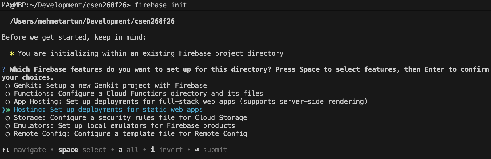
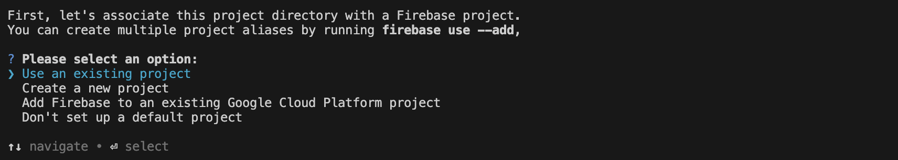
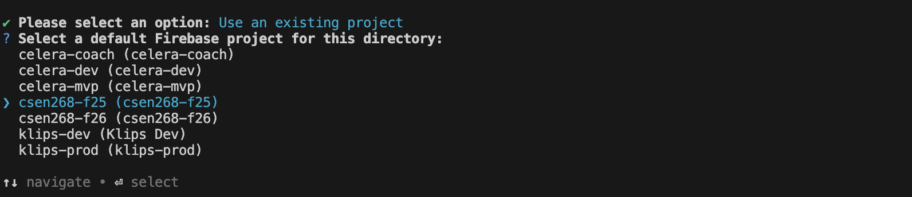
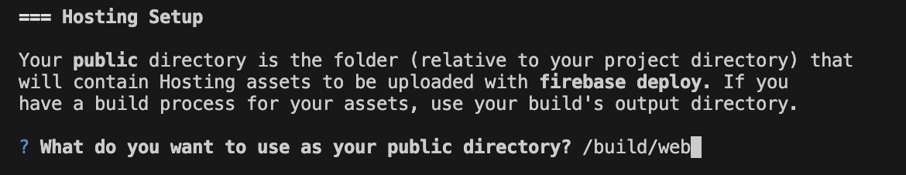
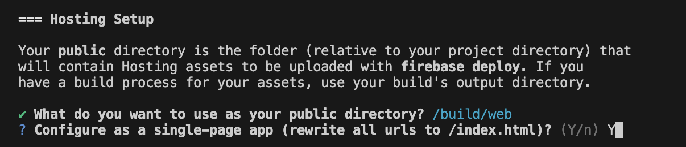
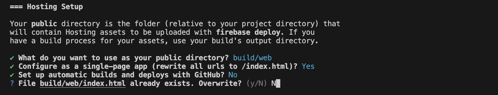
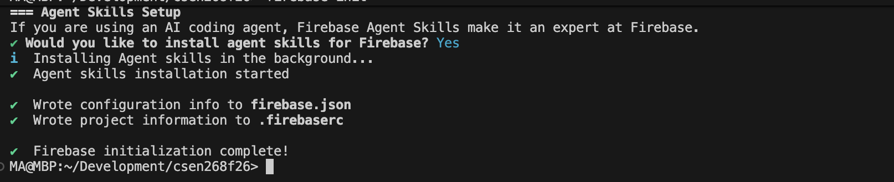
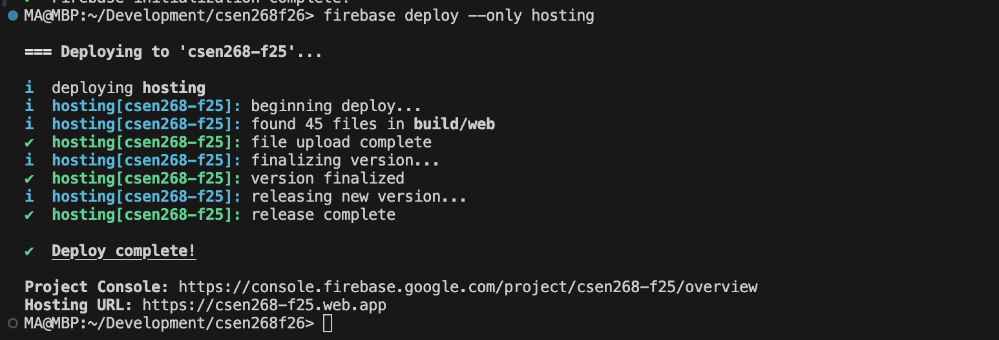
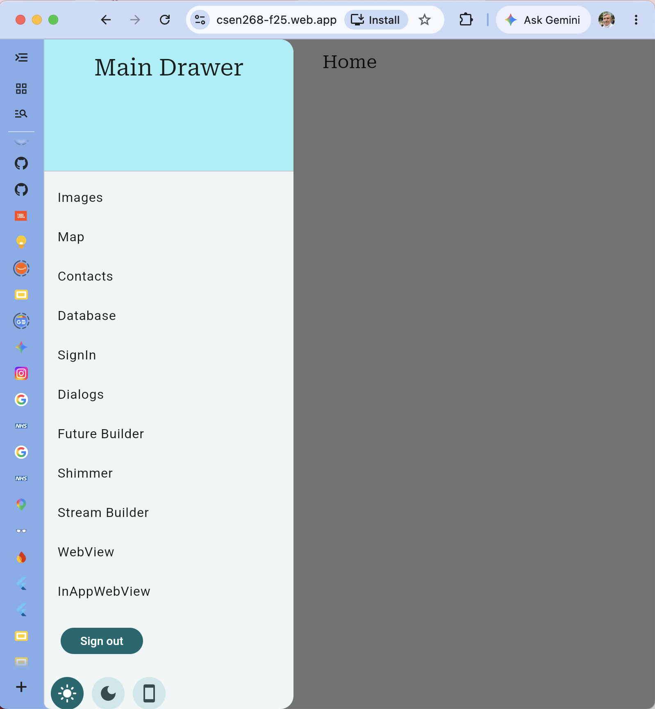

# Lecture 14 - 04 - Flutter Web

## Building your project for web
```bash
flutter build web --release
```

This command will prepare your web application and place the files in `/build/web`. After this step we can set up hosting for firebase.

> Important: If you try the below before compiling for web and without `/build/web` existing, you'll get an error


## Deploying to Web
First prepare `hosting` for your project
```bash
firebase init
```


After selecting `Hosting` we are asked to choose a project:



Highlight the project you want to select:



For the build directory of the web files for hosting, we override the default `public` and supply `build/web`



Click `Y` to configure as a single page web app:



Do not opt for automatic builds and deploys, and do not overwrite the `index.html`



Agent skills can be clicked `Y`



## Firebase setup for hosting contained in `firebase.json`

In the `firebase.json` file we now have an entry for `hosting` which sets out the rules for hosting and also the location of the source file directory 

```json
{
  ...
  "hosting": {
    "public": "build/web",
    "ignore": [
      "firebase.json",
      "**/.*",
      "**/node_modules/**"
    ],
    "rewrites": [
      {
        "source": "**",
        "destination": "/index.html"
      }
    ]
  }
}

```

## Deploying to Firebase Hosting
To deploy only the hosting files (preferred method as otherwise everything will be deployed like functions, database rules, storage rules, etc.)

```bash
firebase deploy --only hosting
```


and finally the app can be accessed at `https://csen268-f25.web.app`




