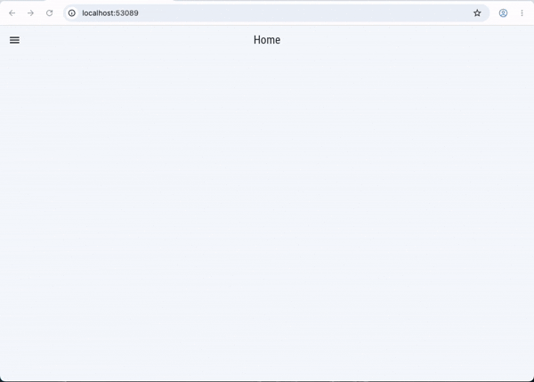

# Lecture 18 - 02 - Generative AI

We now use GenKit to process streaming requests.

## Cloud Functions 
For the environment, you should place your keys in an `.secret.local` file under `functions` to run the functions locally. 
```bash
GEMINI_API_KEY=AI.........zzz
```

For running the cloud functions in the cloud you should set your secrets:
```bash
firebase functions:secrets:set GEMINI_API_KEY<hit return>
```
You will be able to `paste` the key at the command prompt. You will not see the key. To check if the key has gone through:
```bash
firebase functions:secrets:asccess GEMINI_API_KEY
```
this should print out the key on the console.

### GenKit setup
Using these packages in our `index.js`:
```javascript
const { googleAI } = require('@genkit-ai/google-genai');
const { defineSecret } = require("firebase-functions/params");
const { enableFirebaseTelemetry } = require('@genkit-ai/firebase');
const { onCallGenkit } = require("firebase-functions/https");
const { genkit, z } = require("genkit");
```
we define our **AI** model and enable Telemetry for AI Generation Monitoring in Firebase:
```javascript
const ai = genkit({
    plugins: [googleAI()],
    model: 'googleai/gemini-3.5-flash',
});
enableFirebaseTelemetry();
```
### Defining the Flow and Function
First we define a flow which specifies the `inputSchema` and `outputSchema` in terms of the `zod` library. (More info here [zod](https://zod.dev/)).

```javascript
const answerQuestionFlow = ai.defineFlow({
    name: "answerQuestion",
    inputSchema: z.object({
        question: z.string(),
        system: z.string().optional(),
    }),
    outputSchema: z.string(),
    streamSchema: z.string(),
}, async (input, { sendChunk }) => {
    const { stream, response } = await ai.generateStream({
        system: input.system,
        prompt: input.question,
    });
    for await (const chunk of stream) {
        if (chunk.text) {
            sendChunk(chunk.text);
        }
    }
    const finalResponse = await response;
    return finalResponse.text;
});
```
We then define the **Genkit** entrypoint with the `onCallGenkit` function class:
```javascript
exports.answerQuestion = onCallGenkit({
    secrets: ['GOOGLE_GENAI_API_KEY'],
    timeoutSeconds: 540,
}, answerQuestionFlow);
```
This is the streaming version of the `answerQuestion` function. It uses the `stream` method of the `generate` class to stream the response from the model.
Note that this flow is registered as a **streaming** flow, so it will return a `Stream` of chunks instead of a single response.

## Flutter

Add StreamBuilder to process the streaming response:
```dart
Future<void> generateText() async {
    if (userInputController.text.isEmpty || isGenerating) return;

    setState(() {
      isGenerating = true;
      responseText = "";
    });

    try {
      final HttpsCallable callable = FirebaseFunctions.instance.httpsCallable(
        "answerQuestion",
      );
      final result = callable.stream({
        "question": userInputController.text,
        "system": systemInstructionController.text,
      });
      streamSubscription = result.listen(
        (event) {
          if (event is Chunk) {
            final data = event.partialData;
            setState(() {
              if (data is String) {
                responseText += data;
              } else if (data is Map) {
                responseText += data['message'] ?? data.toString();
              } else {
                responseText += data.toString();
              }
            });
            scrollToBottom();
          }
        },
        onError: (error) {
          setState(() {
            responseText += "\n\n⚠️ Error during stream: ${error.toString()}";
            isGenerating = false;
          });
          scrollToBottom();
        },
        onDone: () {
          setState(() {
            isGenerating = false;
          });
          scrollToBottom();
        },
      );
    } catch (e) {
      print(e);
    } finally {
      setState(() {
        isGenerating = false;
      });
    }
  }
```
Here the stream coming back from the cloud function is incrementally shown on the page.

## Scrolling to the bottom
To achieve a good user experience, with new data we add a callback to the scroll controller to animate it to the bottom:
```dart
  void scrollToBottom() {
    WidgetsBinding.instance.addPostFrameCallback((_) {
      if (scrollController.hasClients) {
        scrollController.animateTo(
          scrollController.position.maxScrollExtent,
          duration: const Duration(milliseconds: 300),
          curve: Curves.easeOutQuad,
        );
      }
      if (scrollControllerMarkdown.hasClients) {
        scrollControllerMarkdown.animateTo(
          scrollControllerMarkdown.position.maxScrollExtent,
          duration: const Duration(milliseconds: 300),
          curve: Curves.easeOutQuad,
        );
      }
    });
  }
```

## Resulting flutter output


