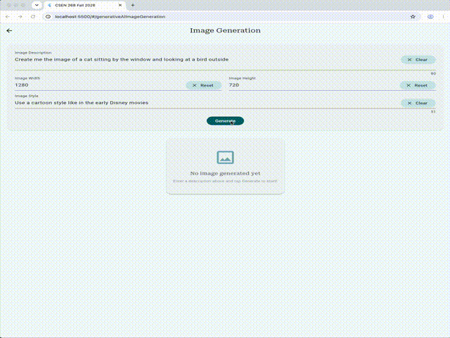

# Lecture 17 - 03 - Generative AI Image

Our flow is defined as:

```javascript
const generateImageFlow = ai.defineFlow({
    name: "generateImage",
    inputSchema: z.object({
        description: z.string(),
        image_style: z.string().optional(),
        width: z.number().optional(),
        height: z.number().optional(),
    }),
    outputSchema: z.object({
        imageBase64: z.string(),
        storagePath: z.string().optional(),
        downloadUrl: z.string().optional(),
    }),
}, async (input) => {
    const result = await imageGenerator(input);
    return result;
});

exports.generateImage = onCallGenkit({
    secrets: ['GOOGLE_GENAI_API_KEY'],
    timeoutSeconds: 540,
}, generateImageFlow);

```

and the call for image generation is achieved with the `imageGenerator` function that invokes `imagen` API. Here we also save a copy to **Firebase Storage** and resize the image to the requested dimensions as the API only accepts an aspect ratio.

```javascript
const imageGenerator = async (schema) => {
    const { description, image_style, width, height } = schema;
    const stylePrompt = image_style ? `Style: ${image_style}. ` : "";
    const prompt = `Create an image based on the following description: ${description}.\n${stylePrompt}`;
    try {
        const result = await ai.generate({
            prompt,
            model: 'googleai/gemini-3.1-flash-image',
            config: {
                aspectRatio: getAspectRatio(width, height),
            },
        });
        console.log(result);
        const media = result.media;
        const dataUrl = media?.url || '';
        let initialBase64 = dataUrl.startsWith('data:') ? dataUrl.split(',')[1] : dataUrl;

        // 1. Convert to Buffer
        let imageBuffer;
        if (dataUrl.startsWith('data:')) {
            imageBuffer = Buffer.from(initialBase64, 'base64');
        } else if (dataUrl.startsWith('http://') || dataUrl.startsWith('https://')) {
            const response = await fetch(dataUrl);
            const arrayBuffer = await response.arrayBuffer();
            imageBuffer = Buffer.from(arrayBuffer);
        } else {
            imageBuffer = Buffer.from(initialBase64, 'base64');
        }

        // 2. Process image with Sharp (Resize if specified, always convert to JPEG)
        let sharpPipeline = sharp(imageBuffer);
        if (width && height) {
            sharpPipeline = sharpPipeline.resize({
                width: width,
                height: height,
                fit: 'cover', // crop and resize to fill the exact dimensions nicely
            });
        }
        const jpegBuffer = await sharpPipeline.jpeg().toBuffer();
        const imageBase64 = jpegBuffer.toString('base64');

        // 3. Save to Firebase Storage
        const bucket = getStorage().bucket();
        const filename = `generated_images/${Date.now()}_${Math.random().toString(36).substring(2, 15)}.jpg`;
        const file = bucket.file(filename);

        await file.save(jpegBuffer, {
            contentType: 'image/jpeg',
            metadata: {
                cacheControl: 'public, max-age=31536000',
            }
        });

        // 4. Get Storage path and Download URL
        const storagePath = file.name;
        const downloadUrl = await getDownloadURL(file);

        return { imageBase64, storagePath, downloadUrl };
    } catch (error) {
        console.error('Error generating image:', error);
        throw new Error('Image generation failed: ' + error.message);
    }
};
```

