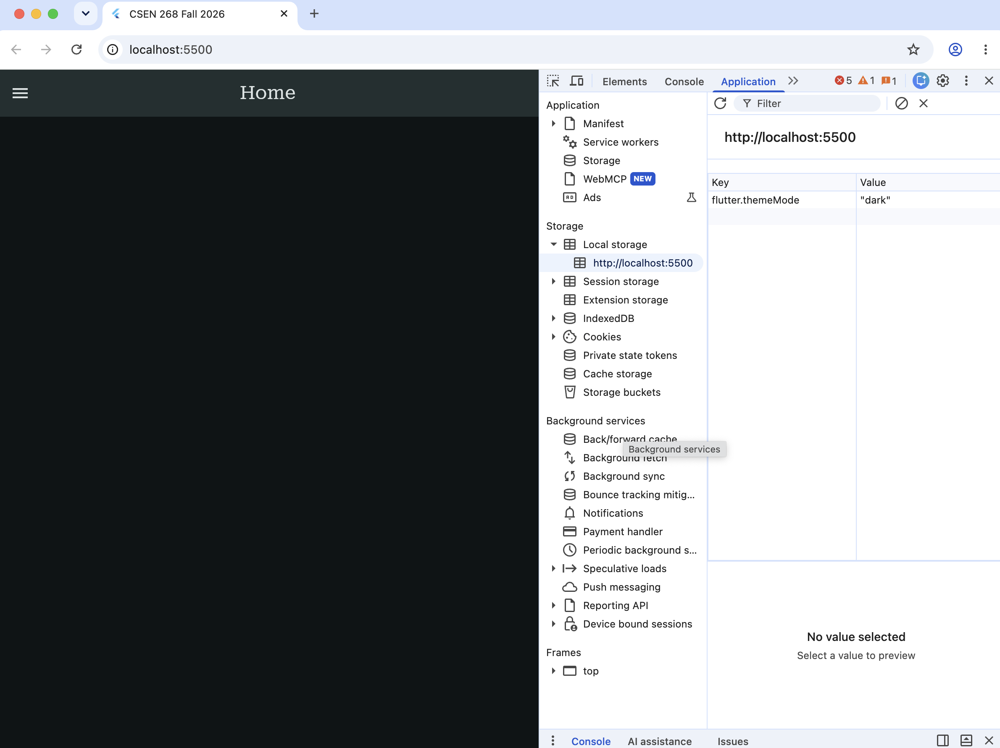

# Lecture 16 -  Step 1 - Shared Preferences

In this lecture we implement shared preferences to save key-value pairs. We add the `shared_preferences` package using:
```zsh
flutter pub add shared_preferences
```

In this example we will implement shared preferences with our brightness selector and save the mode to be able to restart the app with the appropriate setting. 


## Reading the preference
Here in the `theme_cubit.dart` we get the handle to the `SharedPreferences` instance and read the `themeMode` string. We then select the `ThemeMode` enum matching that string and emit that state after the `init()` method has run.

```dart
  late SharedPreferences prefs;

  void init() async {
    prefs = await SharedPreferences.getInstance();
    String themeModePreference = prefs.getString('themeMode') ?? 'system';
    switch (themeModePreference) {
      case 'light':
        themeMode = ThemeMode.light;
        break;
      case 'dark':
        themeMode = ThemeMode.dark;
        break;
      case 'system':
        themeMode = ThemeMode.system;
        break;
    }
    emit(ThemeState(themeMode: themeMode));
  }
```


## Initializing the shared preferences
When we create the `ThemeCubit()` in `main.dart` before injecting it in the `MultiBlocProvider`, we initialize it with `init()`:
```dart
class MyApp extends StatelessWidget {
  ...
  Widget build(BuildContext context) {
    ...
    final themeCubit = ThemeCubit()..init();
    ...
    return MultiRepositoryProvider(
      providers: [
        RepositoryProvider(create: (context) => authenticationRepository),
      ],
      child: MultiBlocProvider(
        providers: [
          BlocProvider(create: (context) => authenticationBloc),
          BlocProvider(create: (context) => themeCubit),
          BlocProvider(create: (context) => NotificationsBloc()..init()),
        ],
        child: BlocBuilder<ThemeCubit, ThemeState>(
          builder: (context, state) {
            ...
```

## Saving the preference at every brightness setting
Whenever we change the brightness, we save the preference:
```dart
  void changeThemeMode(ThemeMode mode) {
    themeMode = mode;
    prefs.setString('themeMode', mode.name);
    emit(ThemeState(themeMode: themeMode));
  }
```

The information is store in the **Local Storage** in the web browser.
