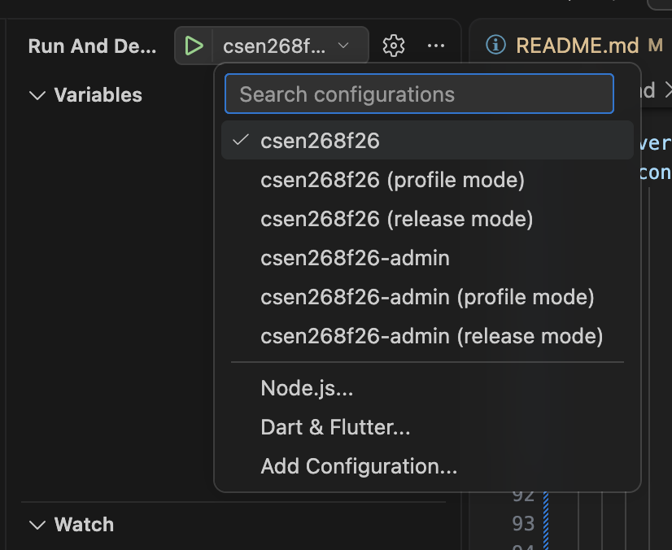
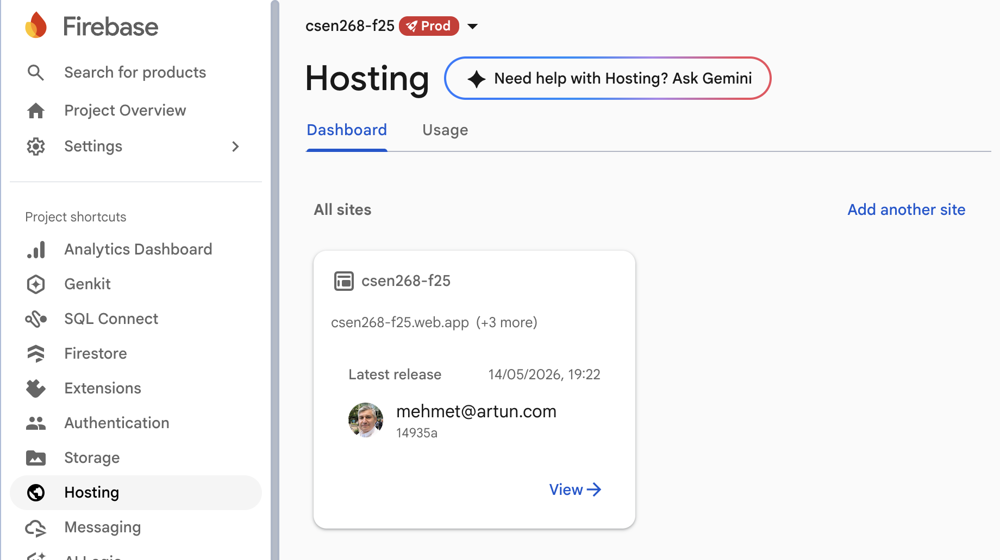
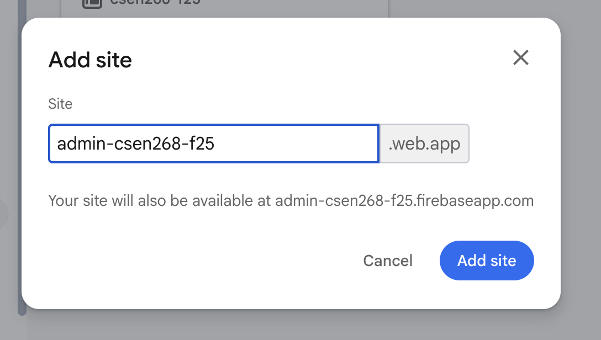
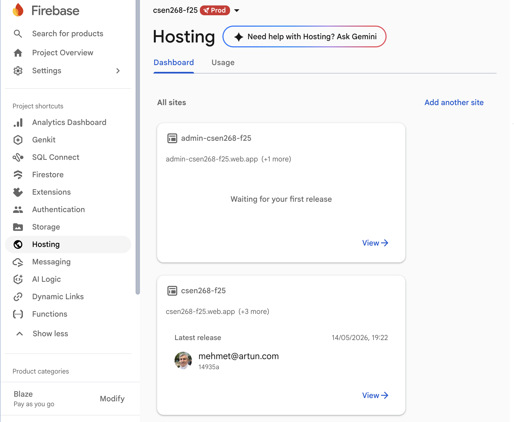
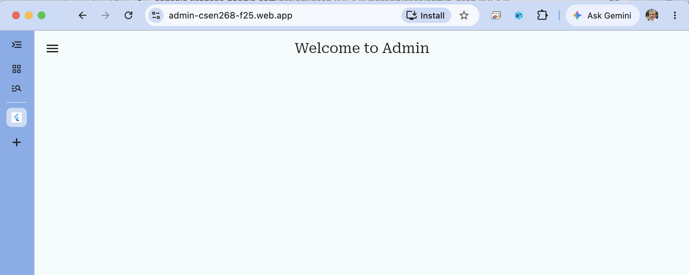

# Lecture 14 - 05 - Other Apps (like an Admin App)

We can create a new app, like an **Admin App** to manage users and other content. In this case we will need to create a few things:

## Another `main` for the new app

Create `main_admin.dart`
```dart
void main() async {
  WidgetsFlutterBinding.ensureInitialized();
  await Firebase.initializeApp(options: DefaultFirebaseOptions.currentPlatform);

  runApp(const MyApp());
}

class MyApp extends StatelessWidget {
  const MyApp({super.key});

  // This widget is the root of your application.
  @override
  Widget build(BuildContext context) {
    final authenticationRepository =
        FirebaseAuthenticationRepository() as AuthenticationRepository;
    final authenticationBloc = AuthenticationBloc(authenticationRepository);
    final themeCubit = ThemeCubit();

    MaterialTheme materialTheme = MaterialTheme(
      createTextTheme(context, 'Roboto', 'Roboto Serif'),
    );

    return MultiRepositoryProvider(
      providers: [
        RepositoryProvider(create: (context) => authenticationRepository),
      ],
      child: MultiBlocProvider(
        providers: [
          BlocProvider(create: (context) => authenticationBloc),
          BlocProvider(create: (context) => themeCubit),
        ],
        child: BlocBuilder<ThemeCubit, ThemeState>(
          builder: (context, state) {
            return MaterialApp(
              title: 'CSEN 268 Fall 2026',
              theme: materialTheme.light(),
              darkTheme: materialTheme.dark(),
              highContrastDarkTheme: materialTheme.darkHighContrast(),
              highContrastTheme: materialTheme.lightHighContrast(),
              themeMode: state.themeMode,
              debugShowCheckedModeBanner: false,
              home: GenericPage(title: "Welcome to Admin"),
            );
          },
        ),
      ),
    );
  }
}
```

## Launch.json 

To create the new compile point we add the following to the `launch.json` file in the directory `.vscode`

```json
{
    "version": "0.2.0",
    "configurations": [
        ...
        {
            "name": "csen268f26-admin",
            "request": "launch",
            "type": "dart",
            "args": [],
            "program": "lib/main_admin.dart"
        },
         {
            "name": "csen268f26-admin (profile mode)",
            "request": "launch",
            "type": "dart",
            "flutterMode": "profile",
            "program": "lib/main_admin.dart"
        },
        {
            "name": "csen268f26-admin (release mode)",
            "request": "launch",
            "type": "dart",
            "flutterMode": "release",
            "program": "lib/main_admin.dart"
        }
    ]
}
```

When compiling the shortcut menu will show the `admin` destinations




## Creating a new hosting site for the admin app
Follow the sequence below to add a new hosting site:







## Modifying the `firebase.json` to include different `targets`
As we have now more than one hosting destination we first need to make sure that we can deploy the contents of the compilation of `main_admin.dart` to that location.

We could do this by modifying `firebase.json` as:
```json
{
  ...
   "hosting": [
    {
      "target": "clientApp",
      "public": "build/web",
      "ignore": [
        "firebase.json",
        "**/.*",
        "**/node_modules/**"
      ],
      "rewrites": [
        {
          "source": "**",
          "destination": "/index.html"
        }
      ]
    },
    {
      "target": "adminApp",
      "public": "build/web_admin",
      "ignore": [
        "firebase.json",
        "**/.*",
        "**/node_modules/**"
      ],
      "rewrites": [
        {
          "source": "**",
          "destination": "/index.html"
        }
      ]
    }
  ]
}
```
In order to make sure the build files get distributed to the correct directory in compiling the **client** and **admin** apps we need to use the following syntax:
```bash
flutter build web --release -t lib/main.dart -o build/web
flutter build web --release -t lib/main_admin.dart -o build/web_admin
```

And finally we need to connect the two different hosting sites `csen268-f25` and `admin-csen268-f25` to the respective targets with:
```bash
firebase target:apply hosting clientApp csen268-f25
firebase target:apply hosting adminApp admin-csen268-f25
```

We will now be able to deploy:
```bash
firebase deploy --only hosting:clientApp
firebase deploy --only hosting:adminApp
```

## Accessing the Admin App
To access the admin app we go to `https://admin-csen268-f25.web.app`

