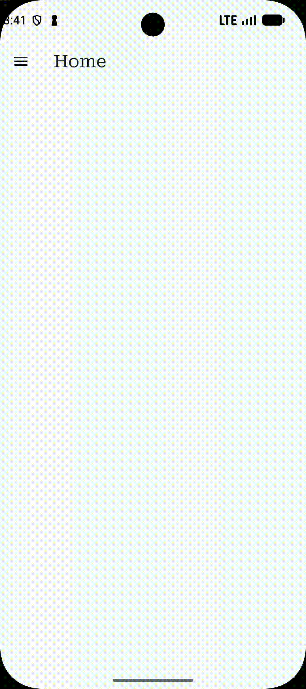

## Lecture 14 - 01 WebView - showing web content in your app
In this lecture we will explore Flutter WebView

There are two packages that allow you to connect to Web from inside the Flutter App. We import both packages:
```zsh
flutter pub add webview_flutter in_app_webview_flutter
```

#### Webview Flutter (developed by Flutter team)
In [web_view_page.dart](/lib/pages/web_view_page.dart) we implement the Webview as a Stateful widget.
```dart
class _WebViewPageState extends State<WebViewPage> {
  GlobalKey<FormState> _formKey = GlobalKey();
  late TextEditingController controller;
  late WebViewController webViewController;
  Uri? uri;
```
Where we define the `WebViewController` that will be attached to the `WebViewWidget` below that displays  the actual web page.
```dart
  @override
  void initState() {
    controller = TextEditingController(text: "google.com");
    webViewController = WebViewController()
      ..setJavaScriptMode(JavaScriptMode.unrestricted);
    super.initState();
  }
```
and we initialized the `WebViewController` with `JavaScriptMode.unrestricted` such that Javascript can be executed within the WebView.
```dart
  void processForm() {
    if (controller.text == null) {
      return;
    }
    if (controller.text.startsWith("https://") ||
        controller.text.startsWith("http://")) {
      uri = Uri.tryParse(controller.text);
    } else {
      uri = Uri.tryParse("https://${controller.text}");
    }
    if (uri != null) {
      webViewController.loadRequest(uri!);
    }
  }
```
This function parses the string in the `TextFormField` to resolve to a web page.
```dart
  @override
  Widget build(BuildContext context) {
    return Scaffold(
        appBar: AppBar(
          title: Text("Web View"),
        ),
        body: Column(
          children: [
            Padding(
              padding: const EdgeInsets.all(20.0),
              child: Form(
                key: _formKey,
                child: TextFormField(
                  controller: controller,
                  decoration: InputDecoration(
                      labelText: "Address",
                      suffix: IconButton(
                        icon: Icon(Icons.send),
                        onPressed: () {
                          processForm();
                        },
                      )),
                ),
              ),
            ),
            Expanded(
              child: WebViewWidget(
                controller: webViewController,
              ),
            ),
          ],
        ));
  }
}
```
And on the page the `WebViewWidget` needs to be wrapped with a `Expanded` widget in order to specify that it can take any available space within the `Column` but not more. Otherwise as the `Column` will grow as much as necessary, the `WebViewWidget` will try to grow to infinity. `Expanded` bounds this which could be achieved with a `SizedBox` or a `Container`.

